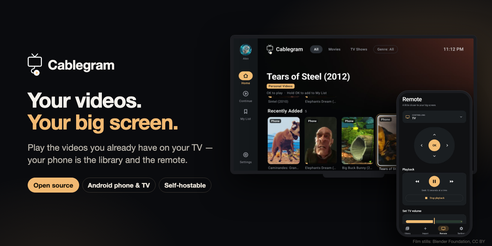

# Cablegram

<p align="center">
  
</p>

**Play the videos you already have on your TV. Your phone is the library and the remote.**

[](https://github.com/seep-labs/cablegram-apps/actions/workflows/ci.yml)
[](LICENSE)
[](https://github.com/seep-labs/cablegram-server)

Cablegram is a personal media player for videos you own. Pick files on your Android phone or keep them in your own
Telegram channel, then play them on your TV with the phone as the remote. Cablegram provides no content and does not
store your videos. This repository holds the open-source phone and TV apps.

## Get the apps

- **Android phone and Android TV / Google TV:** APKs on [GitHub Releases](https://github.com/seep-labs/cablegram-apps/releases)
  (check them with [VERIFY.md](VERIFY.md)).
- **LG and Samsung TVs (preview):** open [tv.cablegram.app](https://tv.cablegram.app) in the TV browser, or follow the
  [LG install guide](https://cablegram.app/lg/). Source in [`apps/tv-web`](apps/tv-web/).
- **iPhone:** the [web remote](https://app.cablegram.app/) controls the TV from Safari (**Share → Add to Home Screen**).

## Run your own server

The apps work with the hosted Cablegram service or with
[Cablegram Community Server](https://github.com/seep-labs/cablegram-server), the open-source, self-hosted server
(GPL-3.0, Docker Compose):

```sh
git clone https://github.com/seep-labs/cablegram-server && cd cablegram-server
cp .env.example .env && docker compose up -d
docker compose logs cablegram   # shows the first-start setup code
```

In the phone app, choose **Join a server** and enter your server's URL and the setup code. Both servers follow the
[contracts](contracts/) in this repository. The hosted service's account, catalog and relay services remain closed
source.

## Features

- **Your library on the phone:** pick files and folders with the system picker; they stay where they are.
- **Play on TV:** stream straight from the phone over your home Wi-Fi, or from your own Telegram channel.
- **Phone as remote:** play, pause, seek and volume, plus the web remote for phones without the app.
- **Profiles:** "Who's watching?" on the TV, optional profile PINs, Continue Watching and My List per profile.
- **Subtitles:** attach a subtitle file and fix its timing from the phone while it plays on the TV.
- **Pairing:** pair a TV with a PIN or QR code; temporary TVs expire on their own.
- **Seven languages:** English, German, Arabic, Farsi, Russian, Spanish and Italian ([details](docs/localization.md)).
- **Telegram, optional:** your login stays on the device (TDLib); see [Telegram channels and Bot Hub](docs/telegram.md).

## Screenshots

<p>
  
  
  
  
</p>
<p>
  
  
  
  
</p>

The videos shown are Blender Foundation open movies under CC BY licences; see
[docs/screenshots/CREDITS.md](docs/screenshots/CREDITS.md). Cablegram doesn't provide films.

## What you can check here

- **Telegram credentials go straight to Telegram.** Both apps use TDLib on the device. Your login code,
  password and session never leave it. The Cablegram server only stores which Telegram account and library
  channel a household uses, and passes a TV's login link (`tg://login?token=`) to the phone so you can approve
  it. See [contracts/telegram-link.md](contracts/telegram-link.md); the server parses those bodies strictly and
  rejects unknown fields.
- **The Telegram surface is small and tested.** `TelegramApiSurfaceTest` (in each app, under
  `src/test/java/app/cablegram/telegram`) uses reflection to assert that the methods of `TelegramApi` equal a
  fixed allowlist. `uploadVideo` is the only method that sends messages; the optional community
  channels can be joined only after you save your selection. The fixed public Bot Hubs feed is also read
  for recommendations; bots are verified by Telegram and added individually only after you confirm
  their permissions and accept the disclaimer. Adding a method fails the test
  until someone changes the allowlist in review.
- **Nothing is logged that shouldn't be.** `TelegramLogAuditTest` covers log output.
- **Cablegram does not store the videos on your phone or in your Telegram channel.** The phone serves them over
  your local network, or through a relay that forwards bytes without keeping them
  ([contracts/relay-protocol.md](contracts/relay-protocol.md)). See the
  [privacy policy](https://cablegram.app/privacy.html) for service data handling.

## Layout

| Path | What |
|---|---|
| `apps/android-phone` | Phone app (Kotlin, Jetpack Compose). Package `app.cablegram.phone`. |
| `apps/android-tv` | TV app (Kotlin, Compose for TV, LibVLC). Package `app.cablegram`. |
| `apps/ios-phone` | iPhone app (Swift, SwiftUI), in development. |
| `apps/tv-web` | LG webOS and Samsung Tizen TV app (TypeScript, Vite). |
| `apps/web-remote` | Web remote for iPhone and other phones without the app: a Home Screen web app, no App Store. |
| `docs/` | [User guide](docs/README.md): pairing, selected files and folders, subtitles, privacy, and troubleshooting. |
| `contracts/` | The API and protocols the apps speak: [control API](contracts/control-api.yaml), [pairing](contracts/pairing.md), [LAN media](contracts/lan-media.md), [remote commands](contracts/remote-and-lan.md), [relay](contracts/relay-protocol.md), [Telegram link](contracts/telegram-link.md), [your own R2 storage](contracts/r2-storage.md). |
| `scripts/check-telegram-sync.mjs` | Fails when the phone and TV copies of the Telegram package differ. |

The Telegram package is copied into both apps on purpose, until a shared module exists. Keep both copies
identical.

## Building

You need JDK 21 (the unit tests use Robolectric, which needs it for SDK 36) and the Android SDK (compileSdk 36). Each app is its own Gradle project:

```sh
cd apps/android-phone   # or apps/android-tv
./gradlew testDebugUnitTest
./gradlew assembleDebug
```

Telegram application credentials are fetched after Cablegram sign-in from the authenticated
`GET /api/telegram/client-config` endpoint over HTTPS. They are held in memory and never embedded
in BuildConfig, stored in app preferences, or supplied to release CI. A new process needs the server
before TDLib can start; a running session keeps working without fetching them again. The backend must
be deployed before distributing these builds. Remote delivery raises the effort to extract the
application identity; someone inspecting a running client can still recover it.

By default the apps talk to `https://api.cablegram.app/`. Override it with `-PCABLEGRAM_API_BASE=https://...`.
The backend is not part of this repository. To point a build at your own host, run
[Cablegram Community Server](https://github.com/seep-labs/cablegram-server), or simply choose **Join a server** in
the phone app at runtime.

To keep the APK small, add `-PCABLEGRAM_ABIS=arm64-v8a` (phone) or the ABI of your device.

## Releases

Tagged releases are built and signed by the [Release workflow](.github/workflows/release.yml) and published
with checksums. See [VERIFY.md](VERIFY.md) to check a download or an installed app.

After the GitHub release is created, the same signed bundles are uploaded to the Google Play **internal
testing** tracks for the phone and TV apps, including release candidate tags.

The upload runs as a Google Cloud service account whose JSON key is the `PLAY_SERVICE_ACCOUNT_JSON` repository
secret. In Play Console (Users and permissions), give that account these permissions on each of the two apps, not at
the account level: *View app information*, *Release apps to testing tracks*, and *Manage testing tracks and edit
tester lists*. Without the testing-track permissions, the account can still upload a bundle, but committing the
release fails with "The caller does not have permission". It needs no production or admin permissions.

## Forks

Cablegram is an unofficial app and is not made or endorsed by Telegram. A fork must use its own Telegram
`api_id` and `api_hash`, and must not call itself "Telegram". Third-party licences are in [NOTICE](NOTICE).

## Contributing and security

See [CONTRIBUTING.md](CONTRIBUTING.md). Report vulnerabilities as described in [SECURITY.md](SECURITY.md).
