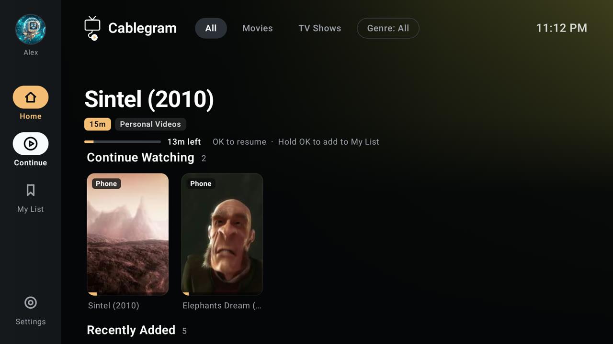
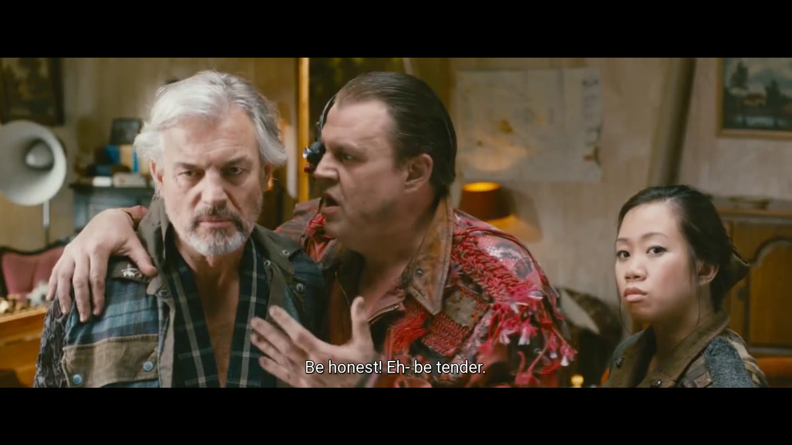
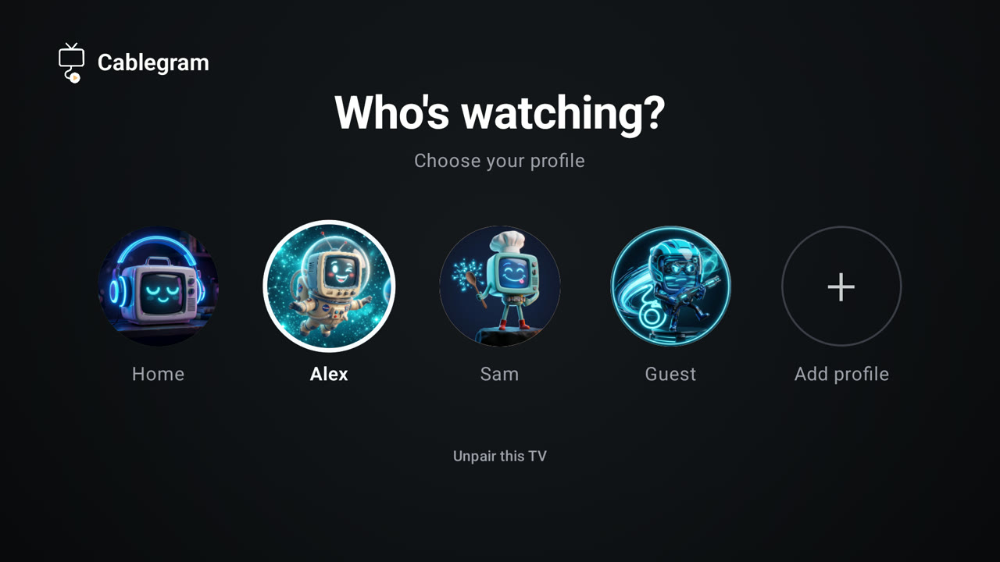
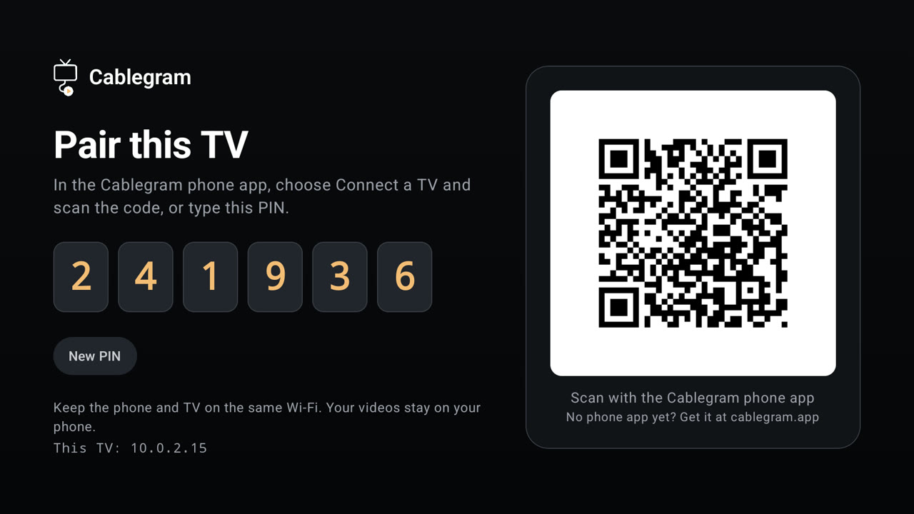
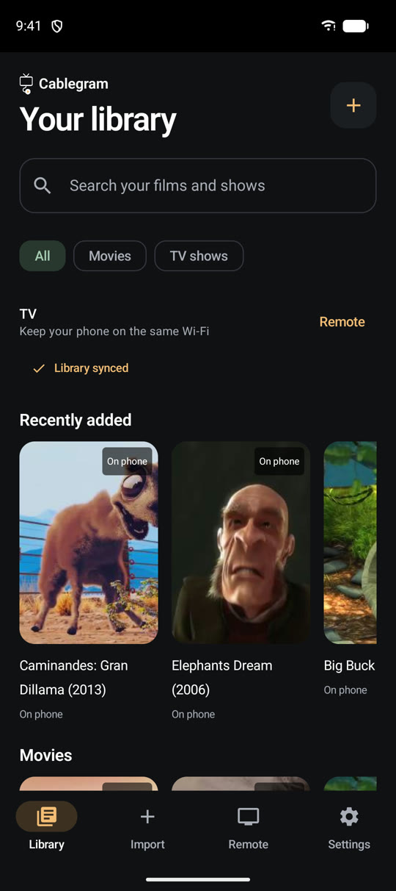
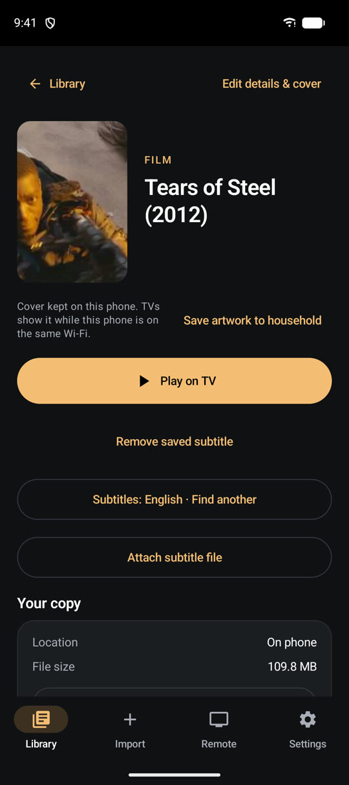
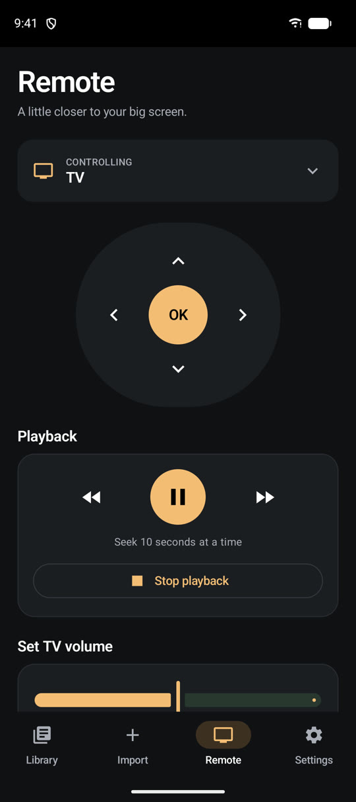
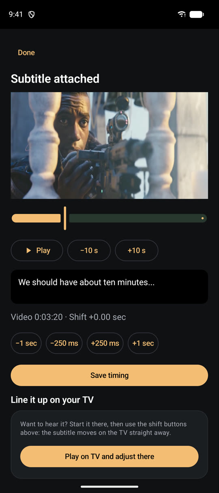

# Cablegram apps

The Android phone app and Android TV app for [Cablegram](https://cablegram.app): play the videos you
already have on your TV, from your phone. Licensed under [GPL-3.0](LICENSE).

**The apps are open source. The Cablegram servers are not.** This repository holds the two apps and the
contracts they follow. The account, pairing, catalog and relay services run separately and are closed source,
the same model Telegram uses for its own apps.

## Telegram channels

Follow Cablegram on Telegram:

- [Cablegram News](https://t.me/CablegramNews)
- [Cablegram Community](https://t.me/CablegramCommunity)
- [Cablegram Bot Hubs](https://t.me/CablegramBotHubs) — Discover useful Telegram bots that make managing, organizing, and enjoying your video library easier.

After connecting Telegram in the phone app, you can choose which channels to join. All three are
selected by default. Uncheck any you do not want, then tap **Save** to join only the selected channels.
Uncheck all and save to continue without joining any.

Next, Cablegram extracts bot recommendations from posts in Cablegram Bot Hubs and
asks about each bot individually. These are independent third-party bots and are not developed,
owned, or operated by Cablegram. Each addition requires reviewing the channel administrator access
and explicitly accepting the disclaimer below; its checkbox starts unchecked for every bot. You can
skip any or all bots. New bots receive posting permission and Telegram’s implied administrator access;
other optional permissions are off. Existing administrator permissions are preserved.

You can reopen the picker any time from **Import → Connected storage → Telegram → Check Bot Hub** while signed in
on this phone. Each check refreshes the recommendations and lets you reconsider previously skipped
bots. Each bot still needs a fresh disclaimer confirmation; existing bot administrator rights are kept.

Cablegram organizes the library channel, joined Cablegram channels, [@CablegramSupportBot](https://t.me/CablegramSupportBot),
and bots you added to the library in a **Cablegram** folder in Telegram. An existing folder is merged,
preserving its chats, pins, appearance, and filters. **Import → Connected storage → Telegram → Organize Telegram folder**
updates it again or retries after a folder-limit or connection error. If a bot has never been started,
Telegram requires you to open it and tap Start before it can appear in the folder; Cablegram reports
those bots and still organizes the other chats. Organizing does not join channels,
start bots, send messages, or add bots to the library.

> This recommendation is shared for informational purposes only. Using the bot is entirely optional and at the user's own discretion and responsibility.
>
> Cablegram is not responsible for the bot's operation, content, privacy practices, or any consequences arising from its use. Please review its permissions before adding it to your channel.

## Languages

The phone and TV apps support English, German, Arabic, Farsi, Russian, Spanish and Italian.
The phone follows its Android language preferences; TV profiles follow the phone or a language
chosen in Settings. Mixed-language TV profiles keep the profile picker in English.
See [app languages](docs/localization.md) for behavior and translation maintenance.

## Screenshots

<p>
  
  
  
  
</p>
<p>
  
  
  
  
</p>

The videos shown are Blender Foundation open movies under CC BY licences; see
[docs/screenshots/CREDITS.md](docs/screenshots/CREDITS.md). Cablegram doesn't provide films.

## What you can check here

- **Telegram credentials go straight to Telegram.** Both apps use TDLib on the device. Your login code,
  password and session never leave it. The Cablegram server only stores which Telegram account and library
  channel a household uses, and passes a TV's login link (`tg://login?token=`) to the phone so you can approve
  it. See [contracts/telegram-link.md](contracts/telegram-link.md); the server parses those bodies strictly and
  rejects unknown fields.
- **The Telegram surface is small and tested.** `TelegramApiSurfaceTest` (in each app, under
  `src/test/java/app/cablegram/telegram`) uses reflection to assert that the methods of `TelegramApi` equal a
  fixed allowlist. `uploadVideo` is the only method that sends messages; the optional community
  channels can be joined only after you save your selection. The fixed public Bot Hubs feed is also read
  for recommendations; bots are verified by Telegram and added individually only after you confirm
  their permissions and accept the disclaimer. Adding a method fails the test
  until someone changes the allowlist in review.
- **Nothing is logged that shouldn't be.** `TelegramLogAuditTest` covers log output.
- **Cablegram does not store the videos on your phone or in your Telegram channel.** The phone serves them over
  your local network, or through a relay that forwards bytes without keeping them
  ([contracts/relay-protocol.md](contracts/relay-protocol.md)). See the
  [privacy policy](https://cablegram.app/privacy.html) for service data handling.

## Layout

| Path | What |
|---|---|
| `apps/android-phone` | Phone app (Kotlin, Jetpack Compose). Package `app.cablegram.phone`. |
| `apps/android-tv` | TV app (Kotlin, Compose for TV, LibVLC). Package `app.cablegram`. |
| `apps/web-remote` | Web remote for iPhone and other phones without the app: a Home Screen web app, no App Store. |
| `docs/` | [User guide](docs/README.md): pairing, selected files and folders, subtitles, privacy, and troubleshooting. |
| `contracts/` | The API and protocols the apps speak: [control API](contracts/control-api.yaml), [pairing](contracts/pairing.md), [LAN media](contracts/lan-media.md), [remote commands](contracts/remote-and-lan.md), [relay](contracts/relay-protocol.md), [Telegram link](contracts/telegram-link.md), [your own R2 storage](contracts/r2-storage.md). |
| `scripts/check-telegram-sync.mjs` | Fails when the phone and TV copies of the Telegram package differ. |

The Telegram package is copied into both apps on purpose, until a shared module exists. Keep both copies
identical.

## Building

You need JDK 17 and the Android SDK (compileSdk 36). Each app is its own Gradle project:

```sh
cd apps/android-phone   # or apps/android-tv
./gradlew testDebugUnitTest
./gradlew assembleDebug
```

Telegram application credentials are fetched after Cablegram sign-in from the authenticated
`GET /api/telegram/client-config` endpoint over HTTPS. They are held in memory and never embedded
in BuildConfig, stored in app preferences, or supplied to release CI. A new process needs the server
before TDLib can start; a running session keeps working without fetching them again. The backend must
be deployed before distributing these builds. Remote delivery raises the effort to extract the
application identity; someone inspecting a running client can still recover it.

By default the apps talk to `https://api.cablegram.app/`. Override it with `-PCABLEGRAM_API_BASE=https://...`.
The backend is not part of this repository, so a build pointed at your own host needs a server that implements
the [contracts](contracts/); we don't provide or support one.

To keep the APK small, add `-PCABLEGRAM_ABIS=arm64-v8a` (phone) or the ABI of your device.

## Releases

Tagged releases are built and signed by the [Release workflow](.github/workflows/release.yml) and published
with checksums. See [VERIFY.md](VERIFY.md) to check a download or an installed app.

## Forks

Cablegram is an unofficial app and is not made or endorsed by Telegram. A fork must use its own Telegram
`api_id` and `api_hash`, and must not call itself "Telegram". Third-party licences are in [NOTICE](NOTICE).

## Contributing and security

See [CONTRIBUTING.md](CONTRIBUTING.md). Report vulnerabilities as described in [SECURITY.md](SECURITY.md).
